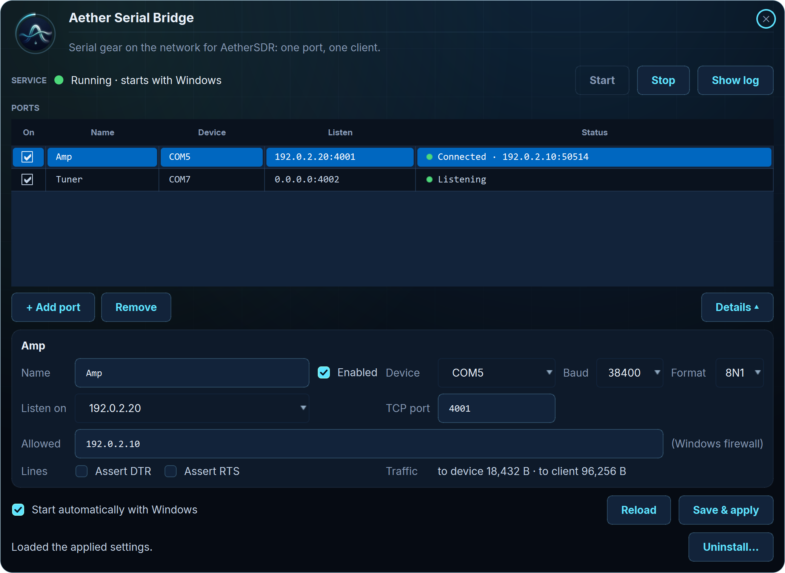

# AetherSerialBridge

**Serial-only station gear on the network, for AetherSDR**

[](https://github.com/AetherSDR/AetherSerialBridge/actions/workflows/ci.yml)
[](https://www.gnu.org/licenses/gpl-3.0)
[](https://en.cppreference.com/w/cpp/20)
[](https://www.qt.io/)
[](https://github.com/AetherSDR/AetherSerialBridge/commits/main)

AetherSerialBridge (the program is *Aether Serial Bridge*) is an [AetherSDR](https://github.com/aethersdr/AetherSDR)
companion. Many amplifiers and antenna tuners (the Elecraft KAT500, KPA500 and KXPA100, ACOM amplifiers and others)
only have a serial port, so their cable has to plug into the computer that runs AetherSDR. The bridge runs on the
computer the cable *is* plugged into, a shack PC or a Raspberry Pi next to the amp, and puts each serial port on the
network as its own raw TCP port. In AetherSDR you set the device to **Network** and enter that host and port.

It moves bytes and nothing more: it doesn't interpret or change the device's protocol. It runs unattended as a
Windows service or a systemd service, and you configure it from a window, a terminal interface or the command line.

**Current version: 1.2.0** | [Download](https://github.com/AetherSDR/AetherSerialBridge/releases/latest) | [Discussions](https://github.com/aethersdr/AetherSDR/discussions) | [What's New](CHANGELOG.md)



---

## Highlights

- **One TCP port per serial port** — raw bytes both ways, one client at a time; the serial port is open only while
  a client is connected
- **Windows, Linux and Raspberry Pi** — a Windows service, or a systemd service on x64 Linux and 64-bit Raspberry Pi
  OS; static programs with nothing to install beside them
- **A window, a terminal interface and a command line** — the window follows AetherSDR's theme; the terminal
  interface works over SSH on a Pi with no desktop
- **Install, update and uninstall from the window** — on Windows with UAC, on Linux with one polkit prompt
- **Safe by default** — DTR and RTS off and out of any client's reach, per-port bind address and allowed clients,
  Windows firewall rules written for you, and a failed change leaves the bridge off, never half-applied

---

## Supported devices

| Device | Serial settings | AetherSDR network support |
|---|---|---|
| ACOM S-series amplifiers | 9600 8N1 | Supported |
| Elecraft KAT500 tuner | 38400 8N1 | In progress upstream |
| Elecraft KPA500 amplifier | 38400 8N1 (check the amp's setting) | In progress upstream |
| Elecraft KXPA100 amplifier | 38400 8N1 | In progress upstream |
| SPE Expert 1.3K / 1.5K / 2K-FA | 115200 8N1 | Use [ser2net](docs/ser2net.md) (needs RFC 2217) |

Settings and safe test commands for each: [docs/devices.md](docs/devices.md).

---

## Download

From the [Releases page](https://github.com/AetherSDR/AetherSerialBridge/releases):

| Your gear is cabled to... | Download |
|---|---|
| A Windows 10 (version 1903 or later) or Windows 11 PC, x64 | `aether-serial-bridge-windows-x64.zip`: the window and the service program, nothing to install |
| A Raspberry Pi with 64-bit Raspberry Pi OS (Bookworm or later) | `aether-serial-bridge-linux-arm64`, plus `aether-serial-bridge-gui-aarch64.AppImage` if you want a window on the Pi's desktop |
| A Linux PC (Ubuntu 22.04+, Debian 12+) | `aether-serial-bridge-linux-x64`, plus `aether-serial-bridge-gui-x86_64.AppImage` if you want a window |
| A 32-bit OS, or a device that needs RFC 2217 (SPE Expert) | [ser2net](docs/ser2net.md) instead |

The release is not code-signed yet, so Windows SmartScreen may warn on first run. Check downloads against
`SHA256SUMS` (see [Verifying downloads](#verifying-downloads)).

---

## Quick start

### Windows

1. Unzip `aether-serial-bridge-windows-x64.zip` anywhere and keep both `.exe` files together.
2. Double-click `AetherSerialBridge.exe`. Opened by a standard user, the window is read-only and says so: click
   **Restart as administrator** and approve Windows' prompt.
3. Click **+ Add port**. Pick the COM port, set the baud rate to match the device, and choose a TCP port
   (for example 4001) and the address to listen on.
4. Click **Install the bridge service** (beside the service's state, top right), or **Install and apply** at the bottom
   right: both install the service `AetherSerialBridge`, its firewall rules and an entry in Settings → Apps, apply
   your ports and start the bridge, asking first. Later changes take **Save & apply**.

To update, unzip the new release and open its window: **Update to this build** replaces the installed program and
keeps your settings. To uninstall, click **Uninstall…** in the window, or use Settings → Apps → Installed apps.
Full guide: [docs/windows.md](docs/windows.md).

### Raspberry Pi / Linux, with a desktop

1. Download `aether-serial-bridge-gui-aarch64.AppImage` for a Raspberry Pi (64-bit Raspberry Pi OS with a desktop), or
   `aether-serial-bridge-gui-x86_64.AppImage` for a Linux PC.
2. In the file manager, open the file's Properties, allow it to run as a program (Permissions → Execute, or "Is
   executable"), then double-click it.
3. Click **+ Add port**, pick the adapter (use the `/dev/serial/by-id/` name), the baud rate, a TCP port and the
   address to listen on.
4. Click **Install the bridge service**. Your desktop asks for an administrator's password once (its prompt says it
   runs `/bin/sh`: [why](docs/linux.md#the-window-x64-desktop-or-a-raspberry-pi-desktop)). The window installs the
   program inside the AppImage and the service, applies your ports and starts the bridge.

To update, open the new release's AppImage and click **Update to this build**. To uninstall, click **Uninstall…**.

### Raspberry Pi / Linux, without a desktop

```bash
chmod +x aether-serial-bridge-linux-arm64
sudo ./aether-serial-bridge-linux-arm64 --install          # installs and starts the service

aether-serial-bridge --list-ports                          # find your adapter's stable name
sudo aether-serial-bridge --add-port Amp \
    /dev/serial/by-id/usb-FTDI_FT232R_USB_UART_DEMO0001-if00-port0 4001 \
    --baud 38400 --bind 192.0.2.20
sudo aether-serial-bridge --apply                          # apply the saved settings
aether-serial-bridge --status
```

Use `aether-serial-bridge-linux-x64` on a PC. `sudo aether-serial-bridge --tui` opens a terminal interface
instead; press `?` there for help. Full guide: [docs/linux.md](docs/linux.md).

### Set up the device in AetherSDR

1. Open the device's settings in AetherSDR (amplifier or tuner).
2. Change the connection from **Serial** to **Network**.
3. **Host**: the bridge computer's address, for example `192.0.2.20` (or its VPN address).
4. **Port**: the TCP port you gave that device, for example `4001`.
5. Connect. The bridge's status now shows *Connected* with AetherSDR's address.

You don't set a baud rate in AetherSDR for a network connection. The bridge holds the serial settings, and
they must match the device.

---

## Safety

Read this before you expose anything.

- **There is no password.** Anyone who can reach a bridge port can key, tune or switch off your amplifier.
  The only protection is who can reach the port.
- **Bind to a LAN or VPN address,** not `0.0.0.0`. To operate from outside the house, use a VPN such as
  WireGuard or Tailscale.
- **Never port-forward a bridge port from your router to the internet.**
- **Firewall it.** On Windows the bridge writes a firewall rule for each port and its allowed clients. On
  Linux, add the rules yourself ([docs/linux.md](docs/linux.md#firewall)). The allowed-clients setting is
  recorded there but not enforced.
- **One client per port.** A new connection replaces the current one, so a second program connecting
  kicks AetherSDR off. Close the vendor utility while AetherSDR is connected.
- **DTR and RTS are off by default** and no client can change them. Some amplifiers use those lines for
  power or PTT.
- **Use `/dev/serial/by-id/` names on Linux.** `ttyUSB` numbers can swap after a reboot, and then a tuner
  command goes to the amplifier.
- **A failed change leaves the bridge off**, across reboots too, never half-applied. Once the cause is fixed,
  click **Start**, or check that the auto-start box is ticked and click **Save & apply**
  ([why the box matters](docs/windows.md#stop-and-auto-start)).

---

## Documentation

| Page | What's in it |
|---|---|
| [docs/windows.md](docs/windows.md) | Windows: the window, update, uninstall, the terminal interface, the service, the command line, files and firewall, troubleshooting |
| [docs/linux.md](docs/linux.md) | Linux and Raspberry Pi: install, adapters and by-id names, the terminal interface, the AppImage window, firewall, troubleshooting |
| [docs/devices.md](docs/devices.md) | Supported devices: serial settings, safe test commands, which bridge to use |
| [docs/clients.md](docs/clients.md) | Virtual COM ports for programs that can only open a local serial port |
| [docs/ser2net.md](docs/ser2net.md) | AetherSerialBridge or ser2net, and the ser2net setup in [`ser2net/`](ser2net/) and [`scripts/install.sh`](scripts/install.sh) |
| [docs/architecture.md](docs/architecture.md) | How it works: the executables, the apply model, data-folder trust, firewall, locks, what runs elevated |
| [CHANGELOG.md](CHANGELOG.md) | What's new in each release |

---

## Building from Source

Dependencies: CMake 3.22+, Ninja, a C++20 compiler (GCC on Linux, MSVC on Windows) and Qt 6 with Qt Serial Port. The
window needs the Qt AetherSDR ships (the GUI floor in [`cmake/qt-pin.env`](cmake/qt-pin.env)); the console program
also builds against a distribution's Qt 6 down to the headless floor there. FTXUI is fetched at configure time.

```bash
cmake --preset linux-dev            # the window and the console program, with the tests
cmake --build --preset linux-dev
ctest --preset linux-dev
```

Other presets: `linux-headless` (the console program only), `linux-distro-headless` (the console program against a
distribution's Qt), `windows-dev` (MSVC developer shell). [`AGENTS.md`](AGENTS.md) has the details, and
[`docs/release-checklist.md`](docs/release-checklist.md) how a release is built and checked.

---

## Contributing

PRs, bug reports, and feature requests welcome! See [CONTRIBUTING.md](CONTRIBUTING.md) for guidelines.

AetherSerialBridge is part of the AetherSDR project and follows its [Constitution](CONSTITUTION.md) and
[governance](GOVERNANCE.md). **Development environment:** the project is developed using
[Claude Code](https://claude.com/claude-code) as the primary development tool. We encourage contributors to use
Claude Code for consistency. PRs must follow project conventions, pass CI, and include signed commits.
[`AGENTS.md`](AGENTS.md) is the guide every AI assistant reads first.

---

## Verifying Downloads

Every release carries `SHA256SUMS`, the SHA-256 of each file. On Linux run
`sha256sum -c --ignore-missing SHA256SUMS` in the download folder; on Windows compare `Get-FileHash <file>` with
its line.

---

## License

AetherSerialBridge is free and open-source software licensed under the [GNU General Public License v3](LICENSE).
Originally written by Ozy (K6OZY) at [cloaked.agency](https://cloaked.agency) for the AetherSDR community.

The window uses AetherSDR's window code, themes and logo, from
[aethersdr/AetherSDR](https://github.com/aethersdr/AetherSDR) (GPL-3.0). The executables also contain Qt
(LGPL-3.0), FTXUI (MIT), the Inter font (SIL OFL 1.1) and SQLite (public domain). The licence texts are in
[`packaging/THIRD-PARTY-NOTICES.txt`](packaging/THIRD-PARTY-NOTICES.txt). ser2net is a separate project and
is not part of this one.

*AetherSerialBridge is an independent project and is not affiliated with or endorsed by the makers of the equipment
it bridges. Elecraft, ACOM and SPE Expert are trademarks of their respective owners.*
