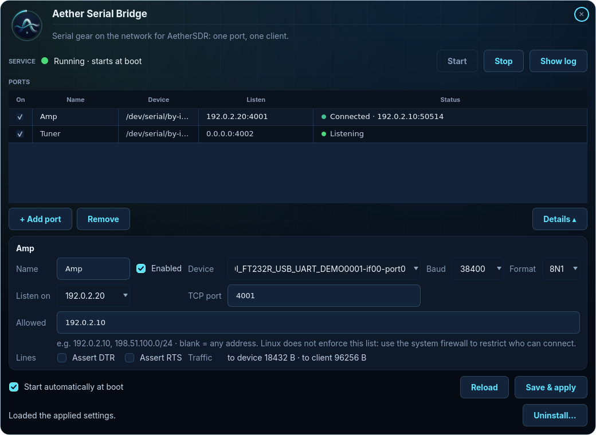

# Supported devices

This page gives the settings and safe test commands for the devices people bridge for AetherSDR. For every
device, the bridge's serial settings must match the device's own. AetherSDR doesn't set the baud rate over
a network connection.

| Device | Serial settings | Bridge | AetherSDR network support |
|---|---|---|---|
| ACOM S-series amplifiers | 9600 8N1 | Aether Serial Bridge or ser2net (raw) | ✅ Supported |
| SPE Expert 1.3K / 1.5K / 2K-FA | 115200 8N1 | **ser2net only** (RFC 2217) | ✅ Supported |
| Elecraft KAT500 tuner | 38400 8N1 | Aether Serial Bridge or ser2net (raw) | 🚧 In progress upstream |
| Elecraft KPA500 amplifier | 38400 8N1 (check the amp's setting) | Aether Serial Bridge or ser2net (raw) | 🚧 In progress upstream |
| Elecraft KXPA100 amplifier | 38400 8N1 | Aether Serial Bridge or ser2net (raw) | 🚧 In progress upstream |
| Elecraft KPA1500 | (built-in Ethernet) | none needed | |

In the window, each port's details (**Details ▴**) hold those settings: the device (on Linux its
`/dev/serial/by-id/` name), the baud rate and format, the address and TCP port it listens on, the allowed clients, DTR
and RTS, and the bytes moved each way while a client is connected:



The **safe** commands below only read state. Use them to prove a bridge port works before you connect
AetherSDR:

```bash
printf 'RV;' | nc -w 2 192.168.1.50 4001
```

Close `nc` (or any other test client) before you connect AetherSDR. There is one client per port, and a
new connection replaces the old one.

## Elecraft KAT500 antenna tuner

| | |
|---|---|
| Serial | 38400 baud, 8N1 |
| Bridge | raw (Aether Serial Bridge or ser2net) |
| AetherSDR network mode | in progress upstream |

The KAT500 uses plain ASCII commands ending in `;`. Safe queries:

| Command | Reply |
|---|---|
| `RV;` | firmware version, for example `RV02.16;` |
| `SN;` | serial number |
| `BYP;` | bypass state |
| `AN;` | selected antenna |
| `VSWR;` | last measured SWR |

## Elecraft KXPA100 amplifier

| | |
|---|---|
| Serial | 38400 baud, 8N1 |
| Bridge | raw (Aether Serial Bridge or ser2net) |
| AetherSDR network mode | in progress upstream |

**Only send caret (`^`) commands to a KXPA100.** The amp passes any command that doesn't start with `^` on
to a KX3 connected behind it. The amp does not answer a plain command such as `RV;` or `FA;`. The command
reaches the radio instead, where it can change the radio's settings.

Safe reads:

| Command | Reply |
|---|---|
| `^SV;` | firmware version |
| `^BN;` | band |
| `^TM;` | temperature |
| `^OP;` | operate / standby state |

## Elecraft KPA500 amplifier

| | |
|---|---|
| Serial | 38400 baud by default, 8N1. **Check the amp's own setting.** The baud rate is configurable, so match what the amp is set to. |
| Bridge | raw (Aether Serial Bridge or ser2net) |
| AetherSDR network mode | in progress upstream |

The KPA500 uses the same caret (`^`) command protocol as the KXPA100. `^SV;` (firmware version) is a safe
first test.

## ACOM S-series amplifiers

| | |
|---|---|
| Serial | 9600 baud, 8N1 |
| Bridge | **raw** (Aether Serial Bridge or ser2net) |
| AetherSDR network mode | supported |

ACOM uses a binary protocol in which the byte `0xFF` is ordinary data. That's why the port must be raw:
telnet mode doubles every `0xFF` and corrupts the messages. Aether Serial Bridge is always raw. In ser2net,
use a plain `accepter: tcp,...` line (see [ser2net.md](ser2net.md)). You can't type binary commands into
`nc`, so test with AetherSDR itself and watch the byte counts (`in=` / `out=`) in `--status`.

## SPE Expert 1.3K / 1.5K / 2K-FA amplifiers

| | |
|---|---|
| Serial | 115200 baud, 8N1 |
| Bridge | **ser2net in telnet + RFC 2217 mode.** Aether Serial Bridge can't do this. |
| AetherSDR network mode | supported |

AetherSDR controls the amp's DTR/RTS lines over RFC 2217, which the remote power-on path needs. Aether
Serial Bridge is raw only and doesn't let a client drive DTR or RTS, so bridge an SPE with ser2net:
`accepter: telnet(rfc2217),tcp,4011`. The example configuration has this line, commented out
([ser2net.md](ser2net.md)). On Windows, use a tool with RFC 2217 server support instead.

## Elecraft KPA1500

The KPA1500 has its own Ethernet port. AetherSDR connects to it directly, so no bridge is needed.

## Other devices

Any device that speaks a byte stream over a serial port works the same way. Match the serial settings,
pick a TCP port, and point the client at it.

If the device needs DTR or RTS held on, tick **Assert DTR** / **Assert RTS** for that port in the window,
or turn them on in the port editor of the terminal interface. The bridge then asserts the line while a
client is connected. Both are off by default, because some amplifiers use those lines for power or PTT.
The client can't change them.
