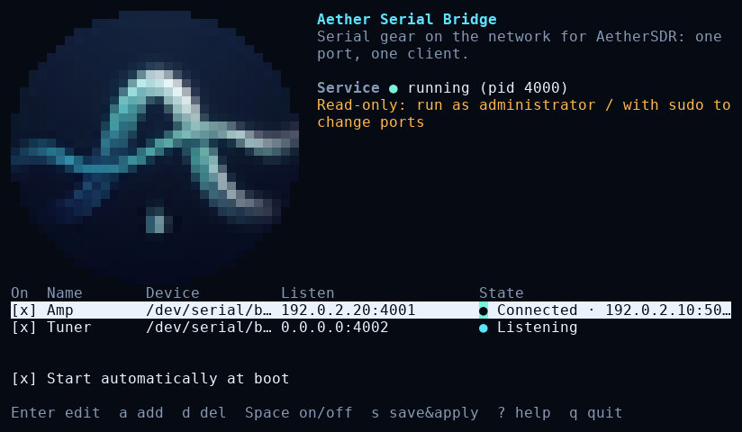
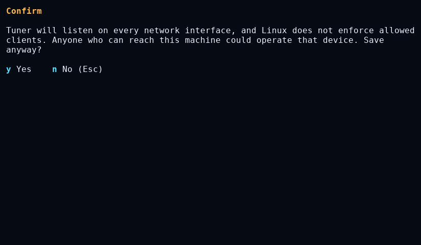
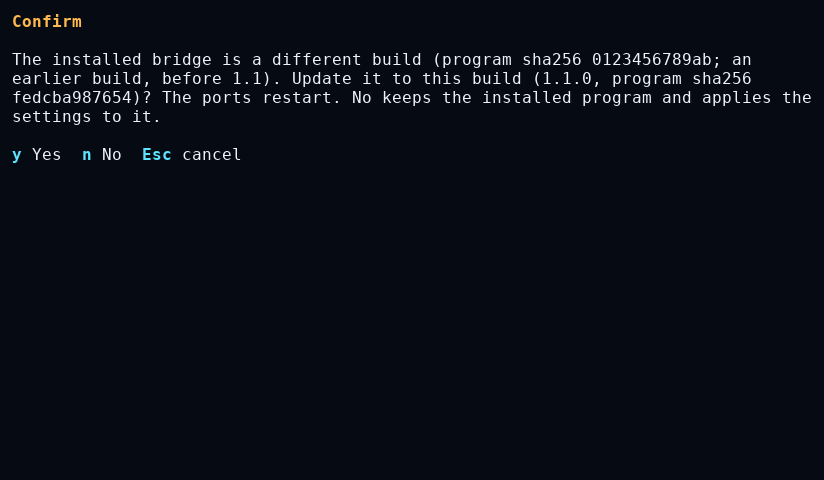
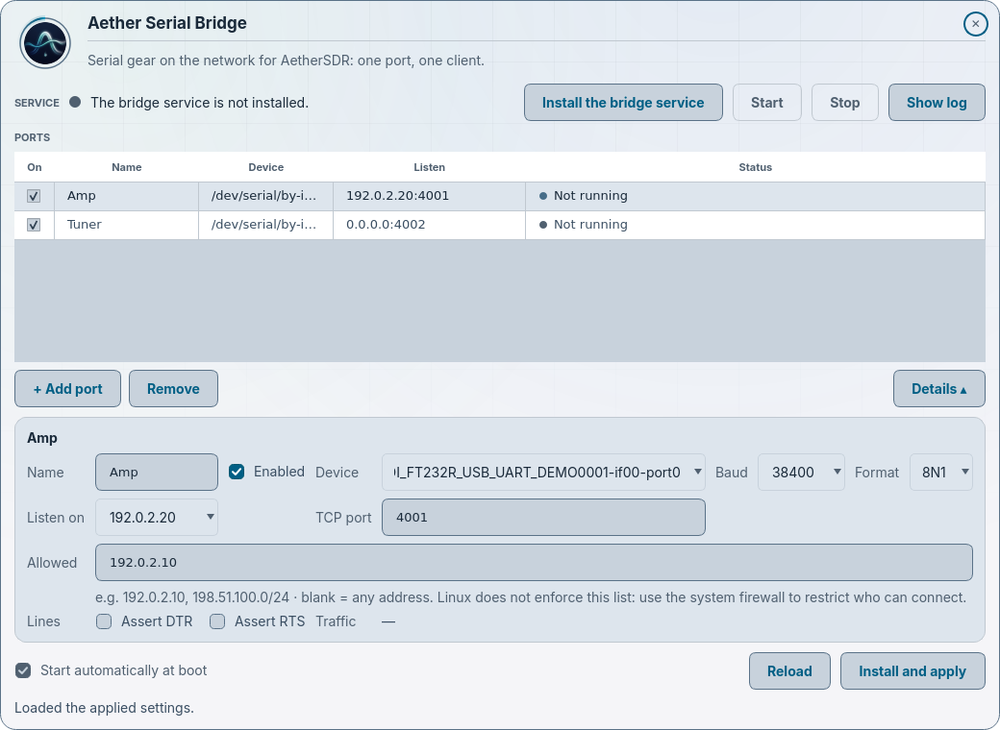
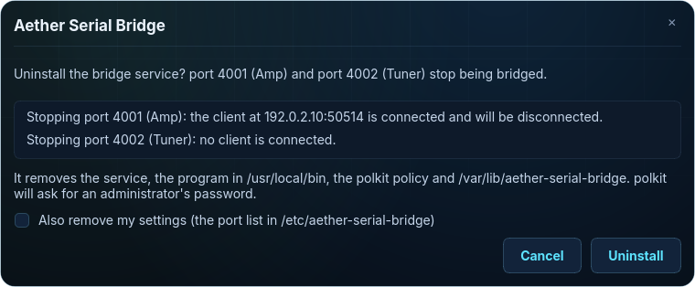
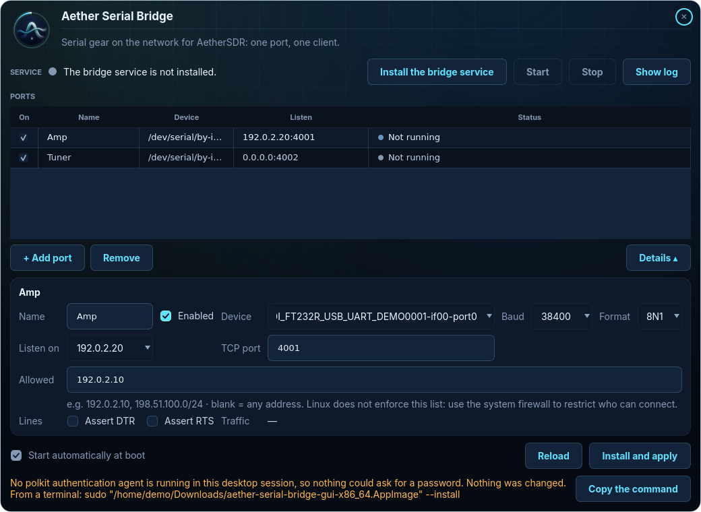

# Aether Serial Bridge for Linux

Linux runs the bridge as a systemd service, configured from the command line, the terminal interface or a
window. A headless Raspberry Pi next to the amplifier is all you need.

## Which file

From the [Releases page](https://github.com/AetherSDR/AetherSerialBridge/releases):

| File | For |
|---|---|
| `aether-serial-bridge-linux-arm64` | Raspberry Pi 3, 4, 5 or Zero 2 W with **64-bit** Raspberry Pi OS (Bookworm or later) |
| `aether-serial-bridge-linux-x64` | A PC or server: Ubuntu 22.04 or later, Debian 12 or later, or similar |
| `aether-serial-bridge-gui-x86_64.AppImage` | Optional: the configuration window for an x64 desktop. It contains the x64 program above. |
| `aether-serial-bridge-gui-aarch64.AppImage` | Optional: the configuration window for a Raspberry Pi with 64-bit Raspberry Pi OS **with desktop** (or reached over VNC). It contains the arm64 program above. |
| `SHA256SUMS` | Digests of every file |

The two `aether-serial-bridge-linux-*` files are single static programs. They contain Qt and the C++
runtime, so there is nothing else to install. They need:

- **glibc 2.35 or newer**: Ubuntu 22.04+, Debian 12+, Raspberry Pi OS Bookworm 64-bit or newer
  (`ldd --version` shows yours);
- **systemd with cgroup v2**, the default on all of the above (`stat -fc %T /sys/fs/cgroup` prints
  `cgroup2fs`);
- a **64-bit** OS. On a Pi, `uname -m` prints `aarch64` on 64-bit. If it prints `armv7l` the OS is 32-bit,
  and the bridge won't run. Use [ser2net](ser2net.md) there, or reinstall with 64-bit Raspberry Pi OS.

macOS is not supported as a bridge host.

Check the download before you run it:

```bash
sha256sum -c --ignore-missing SHA256SUMS
```

The release is **not code-signed**. The digests in `SHA256SUMS` tell you whether a download is complete and
matches the release.

## Install

```bash
chmod +x aether-serial-bridge-linux-arm64
sudo ./aether-serial-bridge-linux-arm64 --install
```

`--install`:

1. Masks the service first, so nothing can start it half-installed.
2. Copies itself to `/usr/local/bin/aether-serial-bridge`. From then on the command is just
   `aether-serial-bridge`.
3. Writes the unit `/usr/local/lib/systemd/system/aether-serial-bridge.service`, and the polkit policy the
   window uses, `/usr/share/polkit-1/actions/org.aethersdr.aetherserialbridge.policy`.
4. Creates the engine lock in `/var/lib/aether-serial-bridge`. On a first install it also writes an empty
   configuration, `/etc/aether-serial-bridge/config.json`.
5. Enables and starts the service, and waits for it to confirm it is running.

To upgrade, run `--install` again from the new file. It replaces the program and keeps your configuration. From
v1.1.0 or earlier, read the next paragraph first.

**Upgrading from v1.1.0 or earlier.** The polkit identifiers moved from `agency.cloaked.aetherserialbridge` to
`org.aethersdr.aetherserialbridge` when the project moved to the AetherSDR organisation. Uninstall the old
installation first, then install the new release:

```bash
sudo /usr/local/bin/aether-serial-bridge --uninstall
sudo ./aether-serial-bridge-linux-x64 --install    # aether-serial-bridge-linux-arm64 on a Raspberry Pi
```

Your configuration in `/etc/aether-serial-bridge` is kept. From a desktop, the new AppImage's **Uninstall…** and then
**Install the bridge service** do the same. Uninstalling first is the supported path for this change: it starts the new
release from a clean installation. As a safeguard, this release's install, update and uninstall also remove the old
policy, `/usr/share/polkit-1/actions/agency.cloaked.aetherserialbridge.policy`, if it is still there.

If `/etc/systemd/system` holds an `aether-serial-bridge.service` unit this program did not write,
`--install` refuses and changes nothing. Remove that unit first.

## Find your serial adapters

```bash
aether-serial-bridge --list-ports
```

```
Stable names (use these in --add-port):
  /dev/serial/by-id/usb-FTDI_FT232R_USB_UART_A10K1234-if00-port0 -> /dev/ttyUSB1
  /dev/serial/by-id/usb-Silicon_Labs_CP2102_USB_to_UART_0001-if00-port0 -> /dev/ttyUSB0
Kernel names (can change after a reboot or replug):
  /dev/ttyUSB0
  /dev/ttyUSB1
```

This only reads directory entries. It never opens a port, so it can't wake or key anything.

**Always use the `/dev/serial/by-id/...` name.** The kernel numbers adapters `ttyUSB0`, `ttyUSB1` in the
order they show up. That order can change after a reboot or when you replug a cable. If the numbers swap,
tuner commands go to the amplifier. The by-id name is built from the adapter's own serial number, so it
always means the same cable. `--add-port` warns you if you give it a `ttyUSB`/`ttyACM` name.

Some cheap adapters have no serial number, so two of them get the same by-id name. They need a udev rule
instead. Find a property that differs with `udevadm info -q property -n /dev/ttyUSB0` (usually `ID_PATH`,
the physical USB socket). Then give each adapter its own name, for example in
`/etc/udev/rules.d/99-aether-serial.rules`:

```
SUBSYSTEM=="tty", ENV{ID_PATH}=="platform-xhci-hcd.0-usb-0:1:1.0", SYMLINK+="kat500"
SUBSYSTEM=="tty", ENV{ID_PATH}=="platform-xhci-hcd.0-usb-0:2:1.0", SYMLINK+="kpa500"
```

Then run `sudo udevadm control --reload && sudo udevadm trigger`, and use `/dev/kat500` in `--add-port`.
These names are tied to USB sockets, so keep each cable in its socket.

## Configure ports

```bash
sudo aether-serial-bridge --add-port <name> <device> <tcp-port> [--baud N] [--format 8N1] [--bind IP] [--allow LIST]
```

| Option | Default | Meaning |
|---|---|---|
| `<name>` | | A label such as `KAT500`. Letters, digits, spaces and `. ( ) -`, up to 40 characters. |
| `<device>` | | The `/dev/serial/by-id/...` path from `--list-ports` |
| `<tcp-port>` | | The port AetherSDR connects to, one per device (for example 4001, 4002, 4003) |
| `--baud` | 38400 | Must match the device's own setting |
| `--format` | `8N1` | Data bits (5-8), parity (`N`one, `E`ven, `O`dd, `M`ark, `S`pace), stop bits (1, 1.5, 2) |
| `--bind` | `0.0.0.0` | The address to listen on. Use the machine's LAN or VPN address. `0.0.0.0` means every interface, and the command warns you about it. |
| `--allow` | | Recorded only. **Linux does not enforce it.** Use a [firewall rule](#firewall). |

Port edits are saved as **saved, not applied** settings (`config.pending.json`). Nothing changes until
`--apply`. Example, a KAT500 and a KPA500 on a Pi at `192.168.1.50`:

```bash
sudo aether-serial-bridge --add-port KAT500 /dev/serial/by-id/usb-FTDI_FT232R_USB_UART_A10K1234-if00-port0 4001 --bind 192.168.1.50
sudo aether-serial-bridge --add-port KPA500 /dev/serial/by-id/usb-FTDI_FT232R_USB_UART_A20K5678-if00-port0 4002 --bind 192.168.1.50
sudo aether-serial-bridge --apply
aether-serial-bridge --status
```

Other commands:

| Command | What it does |
|---|---|
| `aether-serial-bridge --show-config` | The applied ports, any saved, not applied ones, and any problems with them |
| `sudo aether-serial-bridge --remove-port KAT500` | Delete a port |
| `sudo aether-serial-bridge --set-enabled KAT500 off` | Keep a port in the configuration but stop bridging it (`on` to resume) |
| `sudo aether-serial-bridge --apply` | Apply the saved settings: stop the service, commit them, start it |
| `sudo aether-serial-bridge --discard-pending` | Drop the saved, not applied settings |

Every edit is checked before it is saved. A duplicate TCP port, a duplicate device, a bad address or an
unsafe name is refused, and nothing is written. `--add-port` has no DTR/RTS options. Set those in the TUI
or the window.

Don't edit `/etc/aether-serial-bridge/config.json` by hand. The bridge's tools own that file.

## Terminal interface

`aether-serial-bridge` (or `aether-serial-bridge --tui`), in a terminal, opens a text interface: the port list, an
editor for each port (including DTR and RTS), Save & apply, Start, Stop, the log and Repair. It works over SSH, at
80×24 and smaller, and honours `NO_COLOR`. Anyone can look; without root it is read-only and says so. To change
anything, run `sudo aether-serial-bridge --tui`.

- Press `?` for the help page: every key, every field with an example, auto-start, Save & apply and Repair. While you
  edit a port, the line under the form explains the field you are on.
- `s` is Save & apply, `t` starts the bridge, `x` stops it ([Stop and auto-start](#stop-and-auto-start)), `p` lists
  the serial ports (it never opens them), `l` shows how to read the log, `q` quits.
- **Update.** When the installed bridge is a different build, the interface asks as it opens whether to update it to
  this one. `y` replaces the installed program and keeps your settings; the bridge restarts, so connected clients
  drop. `n` or Esc changes nothing, and `u` asks again later.
- **Read-only.** Instead of the question, a read-only interface shows what updating needs, never the bare
  `aether-serial-bridge` (that name is the installed program, the other build):
  - started from the downloaded program: `sudo '<its full path>' --tui`, which opens this build as root;
  - started from the AppImage: `sudo "<the AppImage>" --install`, which installs the AppImage's program and keeps
    your settings;
  - otherwise it says to use **Update to this build** in the window.

  From a desktop, the window's **Update to this build** is the simplest way.



Before it saves, it asks the same questions as the window, for example when a port would listen on every interface
(Linux does not enforce allowed clients), or when the installed program is another build:





## Service, status and logs

| Command | What it does |
|---|---|
| `aether-serial-bridge --status` | Service state. For each port: *Listening*, *Connected* (and from where) or *Error* with its reason, with byte counts. Also says whether the bridge loaded the saved configuration. Why a client was dropped is in the journal and in the TUI or window. |
| `journalctl -u aether-serial-bridge -f` | Follow the log: clients connecting and leaving, ports that fail to open |
| `sudo aether-serial-bridge --start` | Start the service with the saved configuration (after a failed apply, once fixed) |
| `sudo aether-serial-bridge --stop` | Stop it. It stays stopped, across reboots too, until `--start` or `--apply` ([Stop and auto-start](#stop-and-auto-start)). |
| `sudo aether-serial-bridge --repair [--yes]` | Secure `/etc/aether-serial-bridge` if it is not trusted ([below](#files)) |
| `sudo aether-serial-bridge --uninstall [--remove-settings]` | Stop and remove the service, the program, the polkit policy and `/var/lib/aether-serial-bridge`. It first lists the ports that go down and any connected client. The configuration in `/etc/aether-serial-bridge` is kept, and the last line says where; with `--remove-settings` the files the bridge writes there are removed too (any other file, and the folder holding it, stays). |
| `aether-serial-bridge --run --config <file>` | Diagnostic run in the foreground on a scratch configuration ([below](#diagnostic-run)) |

Commands that change something need root and say so if you forget `sudo`. Exit codes: 0 done, 1 failed, 2
usage error, 3 the data folder is not trusted.

Use the bridge's own commands rather than `systemctl start/stop/enable`. An apply masks the unit while it
works and needs a fresh activation token to start. A `systemctl start` without one ends with the service
refusing to run (exit code 6, "not activated"). That is not counted as a failure, so systemd does not restart it.

### What the service is allowed to do

The unit runs the bridge as a throwaway system user (`DynamicUser=yes`) that exists only while the service
runs. That user is in the `dialout` group so it can open serial ports, and otherwise can't change the
system: `NoNewPrivileges=yes`, `ProtectSystem=strict`, `ProtectHome=yes`, `PrivateTmp=yes`. It reads
`/etc/aether-serial-bridge`, which stays root-owned. It writes only `/run/aether-serial-bridge`, for the
status. Device access is not restricted further, so the file permissions on the serial ports
(`root:dialout 0660`) decide. For local settings, use a drop-in: `sudo systemctl edit aether-serial-bridge`.
`--install` rewrites the main unit file.

More detail, including the service's exit codes: [architecture.md](architecture.md#the-service).

### Stop and auto-start

Stop (the window's **Stop**, `x` in the terminal interface, or `--stop`) stops the bridge and keeps it stopped,
across reboots too. An apply that did not finish does the same. Both also turn auto-start off in the terminal
interface; an unfinished apply unticks **Start automatically at boot** in the window too.

To run the bridge again:

- **Start** in the window, `t` in the terminal interface, or `sudo aether-serial-bridge --start`: it starts with the
  applied settings; or
- turn auto-start back on (tick the box, or the auto-start row in the terminal interface), then Save & apply.

With auto-start off, Save & apply does something else, and asks first: going on saves your edits as *Saved, not
applied*, then stops the bridge and keeps it from starting at boot; cancelling changes nothing.

## The window (x64 desktop, or a Raspberry Pi desktop)

`aether-serial-bridge-gui-x86_64.AppImage` is the configuration window for an x64 Linux desktop, and
`aether-serial-bridge-gui-aarch64.AppImage` the same window for a Raspberry Pi with 64-bit Raspberry Pi OS
Bookworm (or later) with a desktop, at the screen or over VNC. Both run as your own user, and you need no terminal
for any step: install, change ports, update and uninstall all happen in the window.

1. Download the AppImage, make it executable in the file manager (Properties → Permissions: "Execute" or "Is
   executable"), and double-click it.
2. With nothing installed, the window shows **Install the bridge service** at the top right. Add your ports, then
   click it, or click **Install and apply** at the bottom right, which does the same. **Start automatically at boot**
   stays ticked until the bridge is installed: there is nowhere to save settings before that.

   

3. The window says what it is about to do, then your desktop's polkit dialog asks for an administrator's password,
   once. Cancel either one and nothing changes.

The polkit dialog says the window wants to run `/bin/sh` as the super user. That is expected: the window runs a short,
fixed script (built into the window) through `pkexec /bin/sh`, and hands it the program inside the AppImage. The
script copies the program into a fresh folder only root can write, `/usr/local/lib/aether-serial-bridge/staging.*`,
checks its SHA-256 against the digest built into the window, and only then runs that copy to install the program as
`/usr/local/bin/aether-serial-bridge`, the service, the polkit policy and `/var/lib/aether-serial-bridge`, apply your
ports and start the bridge. The staging folder is removed when it ends. (An image of the dialog is added after the
hand test.)

Each AppImage carries its program byte-identical to the matching release file (`aether-serial-bridge-linux-x64`
or `-arm64`), so the window installs exactly what [Install](#install) installs.


After the install:

- **Save & apply**, **Start**, **Stop**, **Repair…** and **Discard saved changes** run the installed program
  through `pkexec /usr/local/bin/aether-serial-bridge --helper`. Polkit asks for an administrator's password each time.
  If you cancel, nothing is changed.
- **Update to this build** appears when the installed program is another build than the window's. Save & apply then
  asks first: **Update** installs the window's program (through the staging step above) and applies; **No, keep it**
  (the default) applies your settings to the installed program and keeps it; **Cancel** or Esc changes nothing.
- **Uninstall…** names the ports that go down and any connected client, and has **Also remove my settings**
  (unticked). It removes the service, `/usr/local/bin/aether-serial-bridge`, the polkit policy and
  `/var/lib/aether-serial-bridge`; ticked, also the files the bridge writes in `/etc/aether-serial-bridge` (any other
  file, and the folder holding it, stays). Unticked, the window says where your settings were kept.

  

- Unticking **Start automatically at boot** and clicking Save & apply saves your edits as *Saved, not applied*, and
  stops and masks the service. The window keeps working, so you can turn the bridge back on from there
  ([Stop and auto-start](#stop-and-auto-start)).

**The port's fields** (the window's tooltips and the hint under **Allowed** say the same):

- **Device**: use the `/dev/serial/by-id/…` name ([why](#find-your-serial-adapters)). `ttyUSB0` and `ttyUSB1` can swap
  after a reboot or a replug, and then tuner commands go to the amplifier.
- **Listen on**: the address on this machine that AetherSDR connects to: its LAN or VPN address (for example
  `192.0.2.20`), or `127.0.0.1` for this machine only. `0.0.0.0` means every interface, and the window asks first.
- **TCP port**: what AetherSDR connects to, a different one for each device (for example 4001, 4002).
- **Allowed**: for example `192.0.2.10, 198.51.100.0/24`; blank means any address. **Linux records this list but does
  not enforce it.** Use the system [firewall](#firewall) to restrict who can connect.
- **Start automatically at boot**, under the list: on, the bridge starts at boot.

**Update to a new release.** Download the new AppImage, make it executable and open it. The window sees that the
installed bridge is a different build and shows **Update to this build**. Click it: polkit asks for the password
once, the window installs its own program (through the staging step above), keeps your settings and restarts the
bridge. Then delete the old AppImage. Without a desktop, run `sudo ./<new file> --install`, as in [Install](#install).

**When the window cannot ask.** With no polkit agent in your desktop session (some minimal desktops, or a session
started over SSH with X forwarding), or when polkit refuses, the window says which, changes nothing, and shows the
command to run from a terminal instead, with **Copy the command**: `sudo "<the AppImage>" --install`, or
`sudo "<the AppImage>" --uninstall` (with `--remove-settings` when the box was ticked). The AppImage hands both to the
program inside it.

`--install` from the terminal does **not** carry the window's edits: it installs with the settings already saved on
disk (the saved, not applied ones, else the applied ones), and on a machine with nothing saved, with no ports at all.
The ports you typed into the window are not applied. To finish setting up the ports after it:

- `sudo aether-serial-bridge --tui`, the terminal interface with the same editor as the window; or
- the command line: `sudo aether-serial-bridge --add-port …` for each port, then `sudo aether-serial-bridge --apply`
  ([Install](#install)); or
- the window again, from a desktop session where polkit can ask: after the install every change goes through polkit.



**Starting the AppImage.** The AppImage does not need `libfuse2` (FUSE 2): its runtime mounts itself with
`fusermount3`, from the `fuse3` package, which desktop installations normally have. CI starts the AppImage on a
machine with `fuse3` and without `libfuse2` (`appimage_starts_without_libfuse2`). The runtime mounts the image under
the temporary folder (`$TMPDIR`, normally `/tmp`). Newer Ubuntu releases (26.04, with AppArmor 4.1 or later) allow
`fusermount3` to mount only under your home folder, `/tmp`, `/mnt`, `/media` and `/run/user`; if `TMPDIR` points
anywhere else, or `fusermount3` is missing, the AppImage does not start. Then run it without FUSE: add
`--appimage-extract-and-run` (for example `./aether-serial-bridge-gui-aarch64.AppImage --appimage-extract-and-run`),
or install `fuse3`.

**On the Raspberry Pi:**
- The window draws through X11. Bookworm's desktop (Wayland, with labwc or Wayfire) runs it through XWayland; the
  older X11 desktop and VNC run it directly. (An image of the Pi's desktop with the window is added after the hand
  test.)
- `pkexec` (polkit) and its desktop agent come with the desktop image. On Raspberry Pi OS **Lite** there is no
  desktop: use the plain `aether-serial-bridge-linux-arm64` and its terminal interface.

Started where there is no display (no `$WAYLAND_DISPLAY` or `$DISPLAY`), for example over SSH, the AppImage
shows the terminal interface **read-only**. To make changes there, use `sudo aether-serial-bridge --tui`.

The window follows AetherSDR's theme. It reads AetherSDR's settings without changing them
([architecture.md](architecture.md#the-window-and-the-theme)). **Show log** shows the command to read the
log: `journalctl -u aether-serial-bridge`.

## Diagnostic run

To try a device without touching the service:

```bash
mkdir -m 700 ~/asb-test
./aether-serial-bridge-linux-arm64 --add-port KAT500 /dev/serial/by-id/usb-FTDI_...-port0 4001 --config ~/asb-test/config.json
./aether-serial-bridge-linux-arm64 --run --config ~/asb-test/config.json     # Ctrl+C to stop
```

`--run` needs `--config` with a file outside `/etc/aether-serial-bridge`, in a folder only you (or root) can
write. It listens on this machine only (`127.0.0.1` / `::1`) and refuses to run from the installed
`/usr/local/bin/aether-serial-bridge`, so use the downloaded file. Test it from the same machine, for example
with `nc 127.0.0.1 4001`. `--status --config ~/asb-test/config.json` shows its status. If the service has the
same serial port open, the diagnostic run can't open it either.

## Permissions and dialout

USB serial devices belong to `root:dialout` with mode `660`. The service is already in `dialout`. If you run
`--run` as your own user and get *Permission denied*, add yourself to the group and log in again:

```bash
sudo usermod -aG dialout $USER
```

**ModemManager** is installed on many Ubuntu desktops. It probes new serial devices, can grab a port for a
few seconds after you plug it in, and may send it AT commands. On a dedicated bridge, remove it:
`sudo apt remove modemmanager`.

## Files

| Path | What |
|---|---|
| `/usr/local/bin/aether-serial-bridge` | the installed program |
| `/usr/local/lib/systemd/system/aether-serial-bridge.service` | the unit |
| `/usr/share/polkit-1/actions/org.aethersdr.aetherserialbridge.policy` | the window's polkit action |
| `/etc/aether-serial-bridge/config.json` | the applied settings |
| `/etc/aether-serial-bridge/config.pending.json` | saved, not applied settings (when there are any) |
| `/etc/aether-serial-bridge/start.token` | the activation token |
| `/run/aether-serial-bridge/status.json` | live status (cleared at reboot) |
| `/run/aether-serial-bridge.apply.lock` | held while a change runs |
| `/var/lib/aether-serial-bridge/engine.lock`, `engine.lock.id` | held by the running service |
| `/usr/local/lib/aether-serial-bridge/staging.*` | only while the window installs, updates or uninstalls: the verified copy of the window's program (removed when it ends; uninstall removes `/usr/local/lib/aether-serial-bridge`) |

`/etc/aether-serial-bridge` must be owned by root and not writable by group or others. If it isn't,
`--status` and the window say the data folder isn't trusted, and the service won't start. Run
`sudo aether-serial-bridge --repair`. It moves the folder aside, with everything in it, and creates a fresh
one. Nothing is deleted, and the output names where the old folder went.

`/var/lib/aether-serial-bridge` must be on an ordinary local file system: ext2/3/4, XFS, Btrfs or F2FS. It
cannot be on overlayfs, tmpfs, NFS, SMB or FUSE. `/run` must be tmpfs, as it is on a normal systemd host.
This rules out most read-only-root or overlay setups and ordinary Docker containers. A container whose PID 1
is systemd works if `/var/lib/aether-serial-bridge` is a bind mount from such a file system.

## Firewall

The bridge has no password, so who can reach a port is the only protection. Bind to a LAN or VPN address
and allow only the computers that run AetherSDR. On Linux the bridge does not change your firewall, and
`--allow` is not enforced. Pick the tool your system uses.

**ufw** (Ubuntu, often on Raspberry Pi OS):

```bash
sudo ufw allow from 192.168.1.0/24 to any port 4001:4003 proto tcp
sudo ufw allow in on wg0 to any port 4001:4003 proto tcp      # a WireGuard VPN interface
sudo ufw enable                                                 # make sure SSH is allowed first!
```

**firewalld** (Fedora, some Debian setups):

```bash
sudo firewall-cmd --permanent --new-zone=aether
sudo firewall-cmd --permanent --zone=aether --add-source=192.168.1.0/24
sudo firewall-cmd --permanent --zone=aether --add-port=4001-4003/tcp
sudo firewall-cmd --reload
```

**nftables** (add to `/etc/nftables.conf` inside your `inet filter` table's `input` chain):

```
tcp dport 4001-4003 ip saddr 192.168.1.0/24 accept
tcp dport 4001-4003 drop
```

For access from outside the house, use WireGuard or Tailscale and allow the VPN range (Tailscale uses
`100.64.0.0/10`). **Never port-forward a bridge port on your router.**

## Troubleshooting

| Symptom | Check |
|---|---|
| The window or TUI shows *Listening · last: Could not open ...*, or the journal does | Is the adapter plugged in (`--list-ports`)? Is another program using it (`sudo fuser -v /dev/ttyUSB0`)? Is ModemManager installed? |
| The window or TUI shows *Listening · last: device error: …* | The adapter was unplugged or failed mid-session. Plug it back in. The next client opens it again. |
| *Error: Listener on ... failed* | The `--bind` address isn't on this machine (check `ip -br addr`), or another program uses that TCP port (`sudo ss -ltnp`). The bridge retries every 10 seconds, so a VPN address that comes up late recovers by itself. |
| Connected, but no replies | The baud rate or format doesn't match the device; see [devices.md](devices.md) |
| `--status` says *Activation: none* | The last apply failed or the bridge was stopped. Fix the cause, then `sudo aether-serial-bridge --start` (or `--apply`). |
| *Config error* in `--status` | Run `aether-serial-bridge --show-config`; it lists the problems |
| "No polkit authentication agent is running in this desktop session…" | Your session has no polkit agent, so nothing could ask for a password. Nothing was changed. Run the command the window shows (**Copy the command**) in a terminal, or log in to a full desktop session. |
| "polkit did not allow this; nothing was changed." | polkit refused the request, for example because your account may not administer this machine. Ask an administrator, or run the command the window shows with `sudo`. |
| "The program inside this window does not match its fingerprint; nothing was run." | The AppImage was changed or damaged after its release. Download it again and check it against `SHA256SUMS`. |
| "Nothing was changed: /usr/local is not a directory only root can write." (or `/usr/local/lib`, `/usr`, `/`) | That folder is writable by a group or by everyone (some Debian-family installations), so the window does not stage its program under it. An administrator can make it writable by root only (`sudo chmod g-w,o-w <the folder>`), or use the terminal command the message shows, which does not stage. |
| The AppImage does not start from the file manager | Make it executable (Properties → Permissions). It does not need `libfuse2`: don't install it for this. If it still does not start, see **Starting the AppImage** in [the window](#the-window-x64-desktop-or-a-raspberry-pi-desktop). |
| The window or the terminal interface says a different build is installed | The installed program comes from another release than the one you opened. **Update to this build** (`u` in the terminal interface) installs this one and keeps your settings. **No, keep it** applies your settings to the installed program. |
| The bridge stays off after Stop, and Save & apply offers to deactivate it | The terminal interface's Stop (`x`), or an apply that did not finish, turned auto-start off. Use Start (`t`, `--start`), or turn auto-start back on before Save & apply ([Stop and auto-start](#stop-and-auto-start)). |
| *Permission denied* opening a serial port from your own user (a `--run` diagnostic, a vendor utility) | Add yourself to `dialout` and log in again: `sudo usermod -aG dialout $USER` ([Permissions and dialout](#permissions-and-dialout)). The service is already in that group. |
| A command exits with 1, 2 or 3 | 1: it failed, and the message says why. 2: a mistyped command or option (`--help` lists them). 3: the data folder is not trusted; run `sudo aether-serial-bridge --repair`. |
| `systemctl status aether-serial-bridge` shows exit code 6 | Not an error: the bridge was stopped (Stop, or an apply that did not finish) and waits for Start. Other service exit codes: [architecture.md](architecture.md#the-service). |
| `--service runs only as the aether-serial-bridge system service` in the journal | The host uses cgroup v1 or a hybrid layout, or something other than systemd started the program. Only cgroup v2 under systemd is supported. |
| An error naming `engine.lock` | Another process holds or replaced the lock. The message names the holder. Stop it, or run `sudo aether-serial-bridge --install` to recreate the lock. |
| "the service is not one this program installed" | A unit named `aether-serial-bridge.service` in `/etc/systemd/system` was not written by this program. Remove it, then install. |

## Build from source

The source and the build scripts are in the
[repository](https://github.com/AetherSDR/AetherSerialBridge). `packaging/linux/build-release.sh`
builds the release program against a static Qt, inside an Ubuntu 22.04 container.
