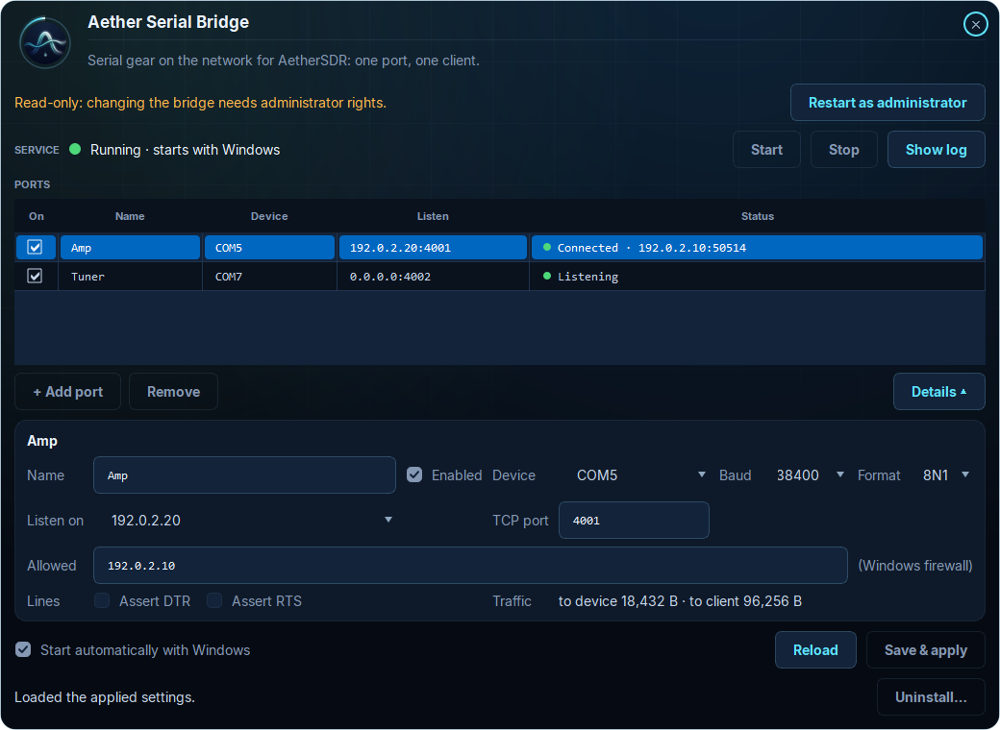
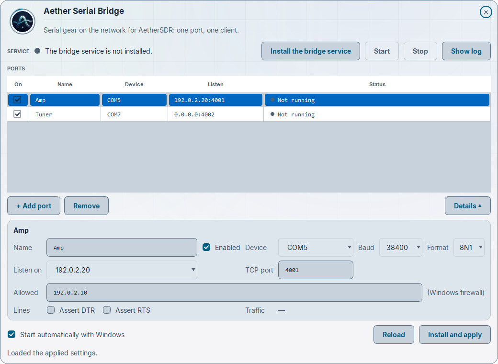
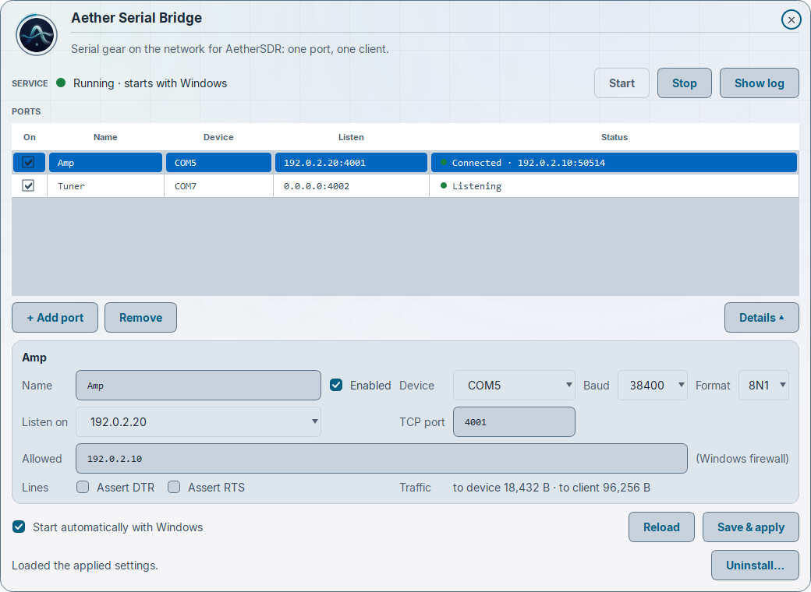
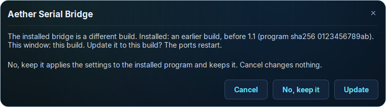
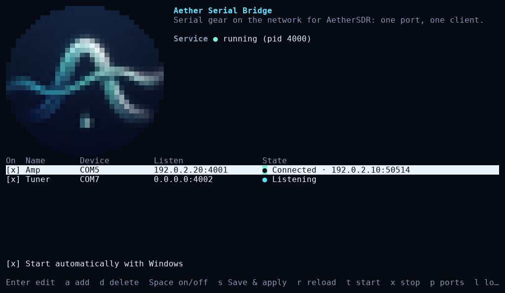
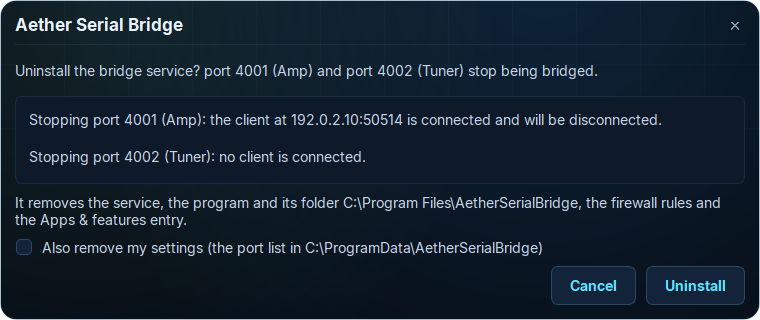

# Aether Serial Bridge for Windows

Windows 10 version 1903 or later, or Windows 11; x64 (the window uses the ICU library Windows ships from 1903 on: on an older build it does not start). You download one zip. There is no separate installer program: the window's **Install the bridge service** (or `--install`) installs the service, copies the program to `%ProgramFiles%\AetherSerialBridge` and adds **Aether Serial Bridge** to Settings → Apps → Installed apps, where you can uninstall it the usual Windows way.

## What's in the zip

`aether-serial-bridge-windows-x64.zip` from the
[Releases page](https://github.com/AetherSDR/AetherSerialBridge/releases) contains:

| File | What it is |
|---|---|
| `AetherSerialBridge.exe` | The configuration window |
| `aether-serial-bridge.exe` | The console program: the Windows service, the command line and the terminal interface |
| licence texts and a short readme | |

Both are single static executables, with no DLLs and no plugins folder. **Keep the two files in the same
folder.** The window installs the `aether-serial-bridge.exe` that sits beside it. It only accepts that file
if the SHA-256 matches the digest built into the window, so the two must come from the same release.

### Check the download

The release also has a `SHA256SUMS` file. In PowerShell:

```powershell
Get-FileHash .\aether-serial-bridge-windows-x64.zip -Algorithm SHA256
```

Compare the hash with the line for the zip in `SHA256SUMS`.

The executables are **not code-signed** yet, so Windows SmartScreen may warn when you first run them.

## Set it up

1. Unzip anywhere, for example to your Downloads folder.
2. Double-click `AetherSerialBridge.exe`. Opened by a standard user, the window only shows the current state: the
   banner says "Read-only: changing the bridge needs administrator rights." Click **Restart as administrator** and
   approve Windows' prompt (UAC); the window reopens with administrator rights. If you had unsaved edits, it asks
   first. Cancelling either question changes nothing. (Right-click → **Run as administrator** does the same.)

   

3. Click **+ Add port** for each device, then fill in the port's details:
   - **Name**: a label such as `Amp`. Letters, digits, spaces and `. ( ) -`, up to 40 characters.
   - **Device**: the COM port, as shown in Device Manager (for example `COM3`).
   - **Baud** and **Format**: must match the device (Elecraft KAT500/KPA500/KXPA100: 38400, 8N1; see
     [devices.md](devices.md)).
   - **Listen on**: the address on this PC that AetherSDR connects to: its LAN or VPN address (for example
     `192.0.2.20`), or `127.0.0.1` for this PC only. `0.0.0.0` means every interface, and the window asks you to
     confirm it.
   - **TCP port**: what AetherSDR connects to, one per device (for example 4001, 4002, 4003).
   - **Allowed**: who may connect, as addresses, blocks or ranges separated by commas, for example
     `192.0.2.10, 198.51.100.0/24`, `100.64.0.0/10` (Tailscale) or `LocalSubnet`. Blank means any address. While
     Windows Firewall is on, this port's firewall rule lets in only these addresses. If you turn Windows Firewall off,
     or another rule lets the port in, the list no longer restricts anything.
   - **Assert DTR / Assert RTS**: leave these off unless your device needs them. Some amplifiers use these
     lines for power or PTT.

   Under the list, **Start automatically with Windows** is ticked: the bridge runs as a Windows service and starts
   with Windows. See [Stop and auto-start](#stop-and-auto-start) before you untick it.
4. Click **Install the bridge service**. The window says what it installs and asks you to confirm (Cancel changes
   nothing). It copies `aether-serial-bridge.exe` to `%ProgramFiles%\AetherSerialBridge` and checks the copy against
   its SHA-256, installs the Windows service `AetherSerialBridge`, creates the firewall rules, adds the Settings → Apps
   entry, applies your ports and starts the bridge.

   

After that, change ports and click **Save & apply**. Keep the unzipped folder: the window runs from there.



The **Status** column shows each port: *Listening*, *Connected · client address*, or the error. The details
card shows the bytes sent to the device and to the client.

The COM port is opened only while a client is connected, so the vendor utility can use it whenever
AetherSDR isn't connected. If a client connects while another program holds the port, the client is
dropped and the status says why. A new client replaces the current one, so a crashed client never locks
the port. More in [architecture.md](architecture.md#a-session).

### The window's buttons

| Control | What it does |
|---|---|
| **Install the bridge service** | Shown when nothing is installed: installs the service, the program, the firewall rules and the Settings → Apps entry, applies the ports and starts the bridge. **Finish installing** in its place finishes an installation that stopped part way. |
| **Update to this build** | Shown when the installed program is another build than this window's: replaces it with this window's program (it asks first), then starts the bridge. |
| **Save & apply** | Apply the edits. This stops the bridge, updates the firewall, then starts it with the new settings. With several ports this can take tens of seconds. With nothing installed it reads **Install and apply** and installs the service with these ports, asking first as **Install the bridge service** does. Untick **Start automatically with Windows** first and it reads **Save**: it only saves your edits as *Saved, not applied*, and installs nothing. |
| **Start automatically with Windows** unticked + Save & apply | Saves your edits as *Saved, not applied*, then stops the bridge and removes the service and its firewall rules. The program and its Settings → Apps entry stay, so you can still uninstall it ([below](#uninstall)) or tick the box again later. |
| **Start** / **Stop** | Start or stop the service with the applied settings. After Stop the bridge stays off, across reboots too, until Start, or Save & apply with the box ticked ([Stop and auto-start](#stop-and-auto-start)). |
| **Uninstall…** | Removes the bridge ([below](#uninstall)). |
| **Restart as administrator** | Only in a standard user's (read-only) window: reopens the window with administrator rights, through UAC. |
| **Show log** | Shows `bridge.log` in the window |
| **Discard saved changes** | Delete the *Saved, not applied* settings |
| **Repair…** | Shown when the data folder isn't trusted ([below](#files)) |
| **Reload** | Read the settings from disk again |
| **Cancel** (bottom right, while waiting) | An operation waits until the window's own firewall check ends ("Waiting for the window's firewall check"); Cancel drops it before it starts. |

**Another build installed.** When the installed program is a different build (an earlier one, or a newer one), Save &
apply asks before it touches it. **Update** replaces the program with this window's and applies; **No, keep it**
(the default) applies your settings to the installed program and keeps it; **Cancel**, Esc or closing the question
changes nothing.



If an apply fails, the bridge stays stopped and won't start at boot either. You never run new settings
under old firewall rules. The message at the bottom of the window says what was saved and what state the
service is in. Fix the problem, then Save & apply again, or click **Start**.

While an operation runs, the window shows "Still processing" and won't close until it finishes. You can
keep editing in the meantime.

### Stop and auto-start

**Stop** stops the bridge and keeps it stopped, across reboots too. An apply that did not finish does the same, and
also unticks **Start automatically with Windows**. (In the terminal interface, Stop turns its auto-start row off too.)

To run the bridge again:

- click **Start**, which starts it with the applied settings; or
- make sure **Start automatically with Windows** is ticked, then click **Save & apply**.

With the box unticked, **Save & apply** does something else, and asks first: **Continue** saves your edits as *Saved,
not applied*, then stops the bridge and removes the service and its firewall rules; **Cancel** changes nothing.

## Update to a new release

1. Download the new zip, unzip it to a new folder, and open its `AetherSerialBridge.exe`. Click **Restart as
   administrator** if the window is read-only.
2. The window sees that the installed bridge is a different build and shows **Update to this build**. Click it and
   confirm. It replaces the installed program with the new one, keeps your settings and restarts the bridge, so a
   connected AetherSDR drops and connects again.

If you click **Save & apply** instead, the window asks the same question first (see **Another build installed**
above). From now on, use the new folder's window; you can delete the old folder.

## Terminal interface

`aether-serial-bridge.exe` (or `aether-serial-bridge.exe --tui`), in a terminal, opens a text interface with the same
operations as the window. Anyone can look. To change anything, open the terminal with **Run as administrator** first;
otherwise the interface is read-only and says so. The window program, `AetherSerialBridge.exe`, has no terminal
interface.

- Press `?` for the help page: every key, every field with an example, auto-start, Save & apply and Repair. While you
  edit a port, the line under the form explains the field you are on.
- `s` is Save & apply, `t` starts the bridge, `x` stops it, `p` lists the COM ports, `l` shows the log, `q` quits.
  `x` also turns the auto-start row off: after it, press `t` to start again, because `s` would offer to remove the
  service ([Stop and auto-start](#stop-and-auto-start)).
- **Update.** When the installed bridge is a different build, the interface asks as it opens whether to update it to
  this one. `y` replaces the installed program and keeps your settings; the bridge restarts, so connected clients
  drop. `n` or Esc changes nothing, and `u` asks again later.
- **Read-only.** Instead of the question, a read-only interface shows the command that updates, with this program's
  full path, for example `"C:\path\to\aether-serial-bridge.exe" --tui`, to run from a terminal
  opened with **Run as administrator**. The full path makes sure you run this build, not another copy.



## Command line

Use `aether-serial-bridge.exe` (the console program) for scripted installs and remote management. Commands
that change something need an elevated terminal (**Run as administrator**). Otherwise they refuse and say
so.

| Command | What it does |
|---|---|
| `--install` | Copy this program to `%ProgramFiles%\AetherSerialBridge`, install the service, create the firewall rules, start it |
| `--apply` | Apply the saved, not applied settings: stop, update the firewall, start |
| `--start` | Update the firewall from `config.json`, then start the service. Use this after a failed apply, once the error is fixed. |
| `--stop` | Stop the service. It starts again only with `--start` or `--apply`. |
| `--uninstall [--remove-settings]` | Stop and remove the service, its firewall rules, the installed program with its folder, and its Settings → Apps entry. It first lists the ports that go down and any connected client. Your settings are kept, and the last line says where. With `--remove-settings` it also removes the files the bridge writes in the data folder; any other file there, and the folder holding it, stays. |
| `--repair [--yes]` | Stop the service and secure the data folder. An untrusted folder is moved aside with everything in it. Asks first unless you add `--yes`. |
| `--discard-pending` | Drop the saved, not applied settings |
| `--list-ports` | List the COM ports Windows knows about. It never opens them. |
| `--show-config` | The configured ports, and any saved, not applied settings |
| `--add-port <name> <COMn> <tcp-port> [--baud 38400] [--format 8N1] [--bind <ip>] [--allow <list>]` | Add a port |
| `--remove-port <name>` | Remove a port |
| `--set-enabled <name> on\|off` | Keep a port in the configuration but turn its bridging on or off |
| `--status` | Service state, each port's state and byte counts, and whether the bridge loaded the saved settings |
| `--run --config <file>` | Run the bridge in this terminal on a scratch configuration, on this machine only ([architecture.md](architecture.md#diagnostic-runs)) |
| `--help`, `--version` | |

`--add-port`, `--remove-port` and `--set-enabled` save to `config.pending.json`. Nothing changes until
`--apply`. Without `--bind`, a port listens on every interface (`0.0.0.0`), and the command warns you.
`--add-port` has no DTR/RTS options. Set those in the window or the TUI.

`--force-recreate` with `--install` or `--apply`: if the data folder is not trusted, move it aside and
start a fresh one.

Exit codes: 0 done, 1 failed (the message says why), 2 usage error (a mistyped command or option), 3 the data folder
is not trusted (run `--repair`). The service has its own exit codes ([all of them](architecture.md#the-service)): 6 means it
was stopped by Stop or an unfinished apply and waits for Start (a normal stop, not an error), and 7 means its firewall
check failed; `bridge.log` says why. Set `ASB_PHASE_TIMES=1` to see where an operation's time went.

Example: install and add a port from an elevated PowerShell in the unzipped folder:

```powershell
.\aether-serial-bridge.exe --install
.\aether-serial-bridge.exe --list-ports
.\aether-serial-bridge.exe --add-port Amp COM5 4001 --bind 192.0.2.20 --allow 192.0.2.10
.\aether-serial-bridge.exe --apply
.\aether-serial-bridge.exe --status
```

## Files

| Where | What |
|---|---|
| `%ProgramFiles%\AetherSerialBridge\aether-serial-bridge.exe` | the installed program the service runs. Uninstall removes it with the folder. |
| `%ProgramFiles%\AetherSerialBridge\apply.lock`, `engine.lock`, `engine.lock.id` | locks ([architecture.md](architecture.md#locks)) |
| `HKLM\SOFTWARE\Microsoft\Windows\CurrentVersion\Uninstall\AetherSerialBridge` | the Settings → Apps → Installed apps entry. `--install` writes it; `--uninstall` removes it last. |
| `%ProgramData%\AetherSerialBridge\config.json` | the applied settings |
| `%ProgramData%\AetherSerialBridge\config.pending.json` | saved, not applied settings (when there are any) |
| `%ProgramData%\AetherSerialBridge\start.token` | the activation token |
| `%ProgramData%\AetherSerialBridge\status.json` | live status, written by the service |
| `%ProgramData%\AetherSerialBridge\bridge.log` (and `bridge.log.1`) | the log. It rolls over at 1 MB. |

The service runs as LocalSystem and trusts its configuration, so only administrators may be able to change
the data folder. If anyone else owns or can write it, the window shows "Config not loaded: the data folder
isn't trusted." and offers **Repair…**. The command line refuses with exit code 3 and points you to
`--repair` or `--force-recreate`. Repair moves the untrusted folder aside with everything in it and starts
a fresh one. Nothing is deleted, and the message names where the old folder went.

Don't edit `config.json` by hand. The bridge only runs a configuration that the firewall was updated from,
and a hand edit breaks that.

## Uninstall

**From the window:** click **Uninstall…**. The question names every port that goes down and any client connected to
it, and has **Also remove my settings** (unticked; Cancel is the default). Uninstall stops the bridge and removes the
service, its firewall rules, the program with the `%ProgramFiles%\AetherSerialBridge` folder and its lock files, and
the Settings → Apps entry, last. Unticked, your settings stay in `%ProgramData%\AetherSerialBridge` and the window says
so; ticked, it also removes the files the bridge writes there (any other file, and the folder holding it, stays).



**From Settings:** Settings → Apps → Installed apps → Aether Serial Bridge → **Uninstall** (on Windows 10 also Control
Panel → Programs and Features). The program asks you to confirm, then Windows asks for administrator permission. A
console window may flash briefly. It removes the same things and always keeps your settings (a message box has no tick
box); to remove them too, use the window's Uninstall… or `--uninstall --remove-settings` from an elevated terminal.
(An image of the entry and of the confirmation is added after the hand test.)

Windows cannot delete a program while it runs, and Settings runs the installed one. That copy is renamed
(`aether-serial-bridge.exe.removed-…`) and deleted, with its folder, when Windows next restarts. The same happens
when you run `--uninstall` from the installed program; from the window, or from the unzipped folder, nothing waits
for a restart. If Windows refuses to schedule that deletion, the copy is renamed back and kept with its entry, and
the result says why. If it cannot be renamed back either, the result names the renamed file: rename it back to
`aether-serial-bridge.exe` and uninstall again, or delete it after the next restart.

If an uninstall stops part way (a lock file it could not mark for removal, or the program in use), the program
and its entry are kept together and the result says so. The window then shows "An uninstall did not finish: the
program is still there." and its **Uninstall…** asks "Finish uninstalling?"; Settings → Uninstall, or `--uninstall`
again, finishes it too.

## Firewall

Every apply rewrites the inbound rules in the Windows Defender Firewall group **Aether Serial Bridge**.
Each enabled port gets one rule: TCP to its port, for the installed program, from its **Allowed** list, on
every network profile (Domain, Private and Public). So fill in Allowed if the PC ever joins networks
you don't trust.

Don't add or edit rules in that group, including through Group Policy. The service checks the group every
30 seconds. If a rule doesn't match the last apply, the service stops itself and stays down until the next
apply. The window then names the rule. Details: [architecture.md](architecture.md#firewall).

## Troubleshooting

| Symptom | Check |
|---|---|
| The window says *Read-only* | Click **Restart as administrator** (or start it with **Run as administrator**) |
| The window or the terminal interface says a different build is installed | The installed program comes from another release than the window or program you opened. **Update to this build** (`u` in the terminal interface) installs this one and keeps your settings. **No, keep it** applies your settings to the installed program. If you didn't expect it, check you opened the newest release. |
| The bridge stays off after Stop, and Save & apply offers to remove the service | The terminal interface's Stop (`x`), or an apply that did not finish, turned auto-start off. Click **Start**, or tick **Start automatically with Windows** before Save & apply ([Stop and auto-start](#stop-and-auto-start)). |
| "Cancelled; nothing was changed." after Restart as administrator, Install, Update or Uninstall… | You cancelled the question or Windows' administrator prompt (UAC). Nothing was changed; click again and approve it. |
| Settings → Apps → Uninstall left `%ProgramFiles%\AetherSerialBridge` | It is removed at the next restart (Settings ran the installed program). The result box says so. |
| Settings → Apps → Uninstall kept the program and the entry | The uninstall stopped part way; the result box says why. Uninstall again from Settings, or **Uninstall…** in the window. |
| Status *Listening · last: Could not open COMx* ("in use", "access denied") | Another program (vendor utility, logger) has the port open. Close it. The bridge opens the port only while a client is connected. |
| Status shows *Listening · last: device error: …* | The adapter was unplugged or failed mid-session. Plug it back in. The next client opens it again. |
| Connected, but the device never answers, or you get garbage | Baud rate or format doesn't match the device ([devices.md](devices.md)) |
| AetherSDR can't connect at all | Wrong address, or the client is not in the port's Allowed list, or the port listens on `127.0.0.1`. Check `--status` shows *Listening* on the right address. |
| AetherSDR keeps disconnecting | Another client is connecting to the same port and replacing it. `--status` shows who is connected. |
| The bridge is off after a reboot | The last apply or Stop left it off on purpose. Run `--start` or Save & apply. `--status` says "Activation: none" in this state. |
| The service keeps stopping after a few seconds | A rule in the *Aether Serial Bridge* firewall group doesn't match. Remove your own rules from that group, then Save & apply. |
| "the service is not one this program installed" | Another program registered a service named `AetherSerialBridge`. Remove it, then install. |

## Build from source

The source and the build scripts are in the
[repository](https://github.com/AetherSDR/AetherSerialBridge). The release build links Qt 6
statically. See `CMakePresets.json` and `packaging/qt-static/`.
